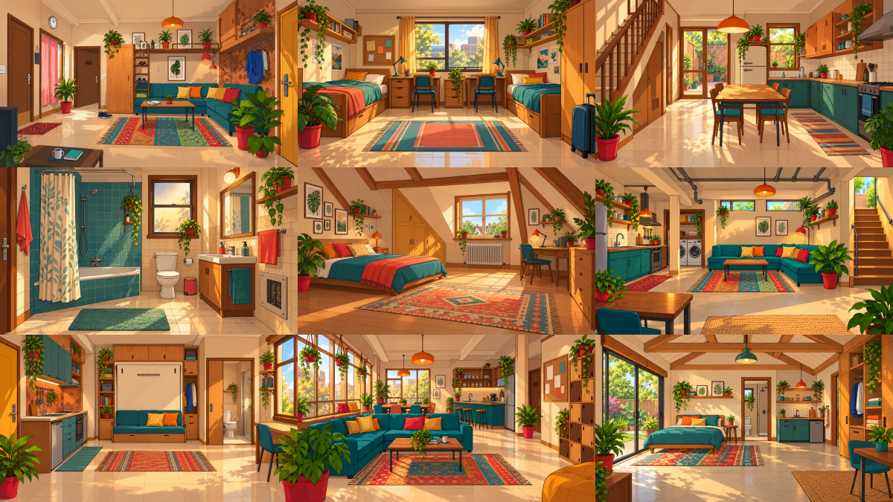

# 押金保卫战 · Deposit Wars

一款以年轻人租房经历为题材的 **2D 看图找茬解谜游戏原型**。玩家可选**租客**或**房东**视角，在房间中找物件、判断问题，并逐步查清押金争议。

> **现在能玩的是九关玩法 Demo。** 九种住房场景和双视角均可体验；案例专属揭露、Inspection Phone 与押金结算尚未接入这九关。仓库内另有一份旧单房间原型，展示完整取证与结算流程。项目尚未上线。

## 先玩哪一个？

| 入口 | 你会体验到 | 当前边界 |
| --- | --- | --- |
| **[九关 Demo](game/nine-level-demo.html)** | 九种住房、租客/房东双视角；拾取物件进入固定大小的物品栏，选线索后点击房间问题区域标注 | 每关每视角有两处待标注问题；专属揭露、Phone 和押金结算尚未整合 |
| [旧单房间原型](game/offline-demo.html) | 一间房的拖动检查、Inspection Phone 取证、扣款核对与虚构押金结算 | 用来验证完整玩法循环，不代表九关都具备这些功能 |

**打开方式（无需安装 Node.js）：** 在 GitHub 点击 **Code → Download ZIP**，解压整个仓库，然后用浏览器打开 `game/nine-level-demo.html`。也可以克隆仓库后打开同一文件。请保留文件夹结构，九关页面要读取旁边的脚本与 `game/public/` 图片。GitHub 的代码预览页只显示文件内容，不会直接运行游戏。

## 九关 Demo 怎么玩

1. 选顶部关卡，再选**租客**或**房东**。九关可以自由预览。
2. 在房间里**按住并拖动物件**，也可以点击或用键盘聚焦拾取。与当前身份有关的正确物件会进入下方物品栏；干扰物不会进入。
3. 点选物品栏里的线索，再点击你认为有问题的房间位置。线索与区域对应、且该问题所需物件都已收齐，才会留下标记并计分；标错可重试。
4. 本关标出两处问题后，可以点**下一关**。物品栏外框始终等大，开放卡槽从前期的 2 格逐渐增加到后期的 6 格。

九种住房依次是海景公寓、校园宿舍、联排屋、老式步梯公寓、独栋洋房、地下室套间、微型单间、青年长租公寓和后院小屋。房间与案例物件不同，统一采用首关的暖色手绘画风。

## 当前进度与资料

- **已做：** 九关场景与物件 PNG、两身份共 36 个案例改编问题的拾取/标注机制；旧单房间完整玩法原型。
- **待做：** 九关逐案例隐藏揭露美术、Phone 取证和押金结算整合、真实玩家试玩与性能验证。当前为 G2 本地原型，未进入正式发布。
- [九关玩法与案例配置](deposit_wars_skills/artifacts/design/TASK-018_NINE_LEVEL_SYSTEM.md) · [九关美术说明](deposit_wars_skills/artifacts/art/TASK-018_NINE_HOMES_ART.md) · [项目当前状态](deposit_wars_skills/shared/PROJECT_STATE.md)
- [开发、构建和测试说明](game/README.md)

案例取自公开租房经历并进行了虚构改编；房间里的物理异常不自动证明某一方有过错。
