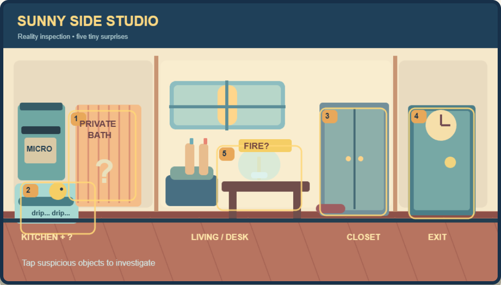
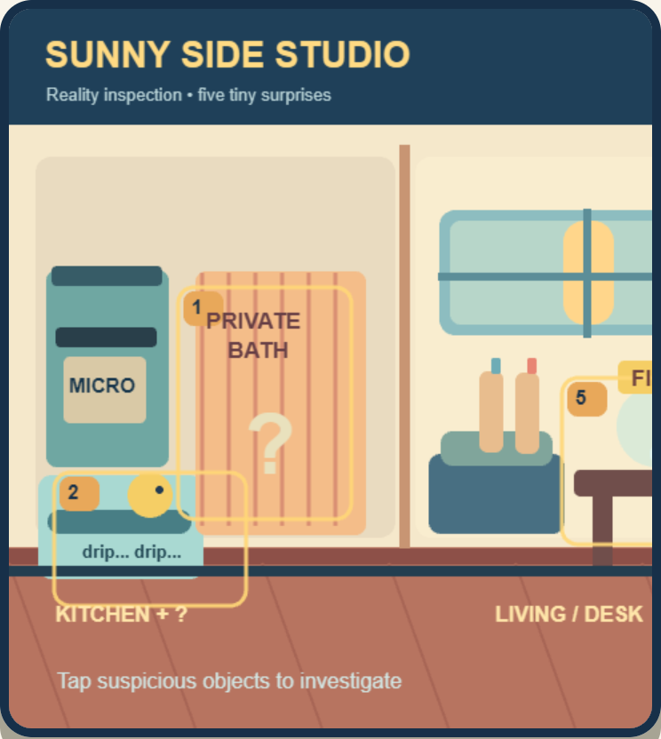
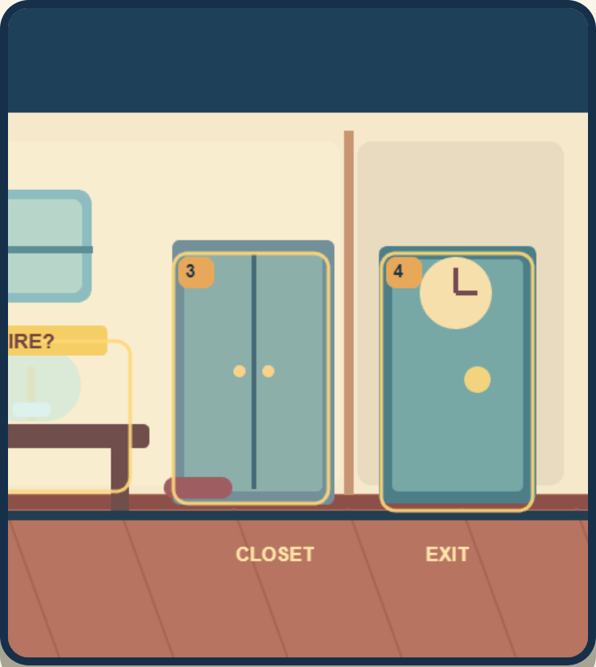

# Sunny Side Studio 实际场景预览

TASK-005｜2026-10-22｜状态：供 CEO 审核｜来源：本地 G2 Phaser 原型，经 `node tests/visual-review.mjs` 于 Chrome 截取，未经修图。

## 桌面完整房间

[实际运行：桌面完整页面](review/actual-desktop-page.png)。桌面 1280×900 视口，房间 960×540 逻辑画布；全屋及五个热点一次可见。房间源代码：`../../../game/src/room.ts`。

## 手机视口

390×844 CSS 视口、2 倍设备像素、Chromium 触屏模拟；下图是**同一房间横向滚动的左右两段**，不是两间房。它们只验证模拟视口，尚未在物理手机上审美或测可读性。

[实际运行：手机完整页面左段](review/actual-mobile-page.png)。D1 和 D2 首屏可见；D3、D4 要横向查看；D5 位于中段。当前黄色编号边框是原型引导层，便于操作但会降低自主找茬感。完整页面需向下滚动才能看到按钮。概念图与此实际画面分开保存，不能当作实机截图。

## 五个热点在完整场景中的位置

`左：D2 滴水浴角 + D1 微波炉旁浴帘 ｜ 中：D5 蜡烛罩 ｜ 右：D3 衣柜 + D4 时钟门`。

当前画面为正面剖面加少量斜线地板，并未真正实现明显的斜视透视。若 CEO 选择精致斜视卡通，后续资源制作时须先定透视网格与热点对位，不得把概念图直接替换为可玩的碰撞/点击图层。
