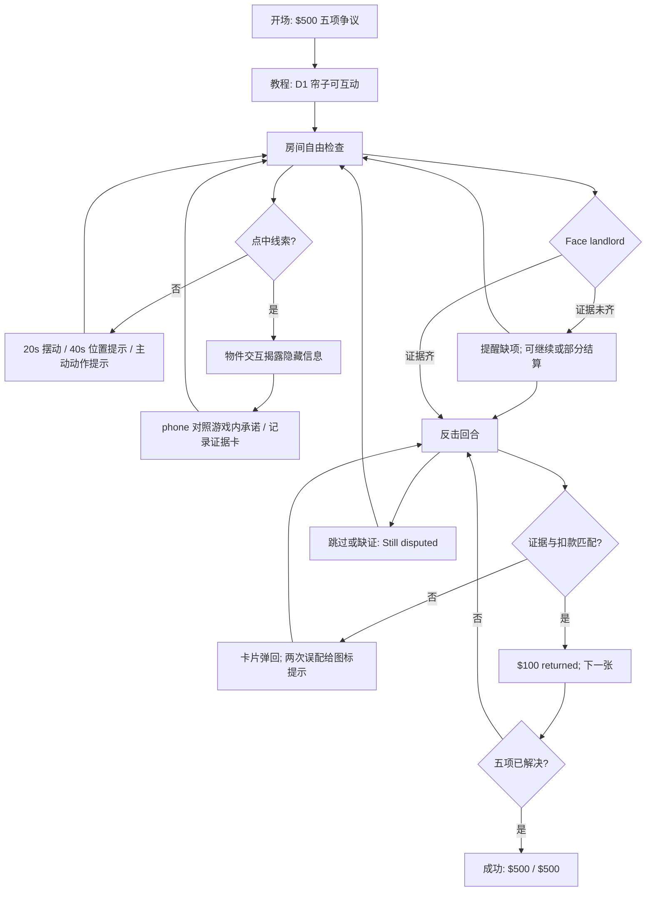

# LEVEL-001 状态流程与低保真交互示意

版本 1.0｜TASK-003｜设计图，非游戏代码

## 状态流程



同一会话状态：`revealed`、`evidence_collected`、`charge_resolved` 按 D1–D5 分别记录。`charge_resolved` 只有匹配正确才能置真；错误选择不变。回房保留三组状态。反击中重复查看证据不消耗卡。结算为本关模拟反馈，非现实争议结果。

## 16:9 主场景低保真布局

```text
┌───────────────────────────────────────────────────────────────┐
│ $500 at stake       EVIDENCE 0/5             [?]        [♫] │
│                                                               │
│ ┌────── kitchenette ──────┐  ┌──── living ────┐ ┌──── entry ┐│
│ │ microwave              │  │  desk: D5       │ │ clock D4 ││
│ │ curtain D1  ▒▒▒        │  │  candle dome    │ │   🚪      ││
│ │ toilet silhouette      │  │                │ │ outside  ││
│ │ shower D2  • duck      │  │ closet D3 👞   │ │ chalk sun││
│ └─────────────────────────┘  └─────────────────┘ └───────────┘│
│                                                               │
│  [📱 LISTING / COMPARE]        [FACE LANDLORD →]              │
└───────────────────────────────────────────────────────────────┘
```

图只表示物件关系，正式画面不用 emoji。D1 位于初始焦点，D2 与 D1 共浴室细节却是不同热点；D3 在中央偏右；D4 最右；D5 中央桌面。每个热点扩大点击范围，不要求精准点击小蘑菇或烛芯。局部检查层居中弹出，背景变暗而仍可定位原位置。

## 触屏与键盘走向

- 横屏：整个房间适配可见，细节层放大；手机窄屏若读不清，横向两段平移，D1 必须保持在首屏。竖屏只提供 `Rotate for best view` 或简化布局，由 G2 测试选择，不以强制横屏为既定平台要求。
- 主交互：轻点=检查/开合；帘子也可拖，但点击必须等价；不使用需要鼠标悬停的隐藏动作。
- UI 按钮、放大层关闭和五张证据卡均可键盘焦点访问；`Esc` 关闭局部层；同一动作支持触屏/鼠标。
- 证据反击可以点证据、再点扣款，不要求拖拽；拖拽只是桌面版表现。

## 最短路径与容错

教程点 D1 → 观察/揭露 → phone `Compare` → 第 1 张证据，三次以内明确动作，设计目标 ≤25 秒。玩家一开始可以点其他四处，不因未完成教程而封锁。若玩家直接点 `Face landlord`，给缺项提示；如果继续，部分争议可反驳并回房补查。任何时刻不丢已得证据。
